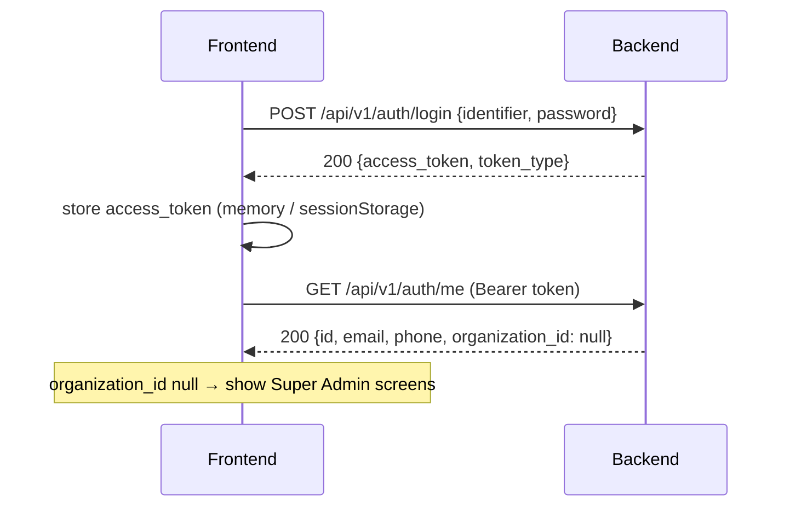
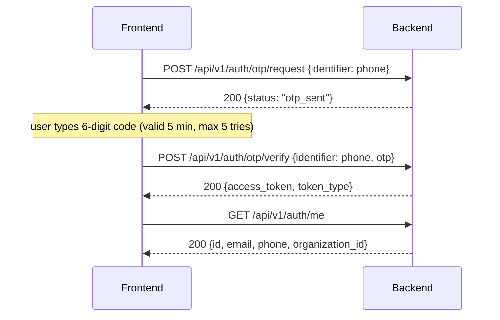
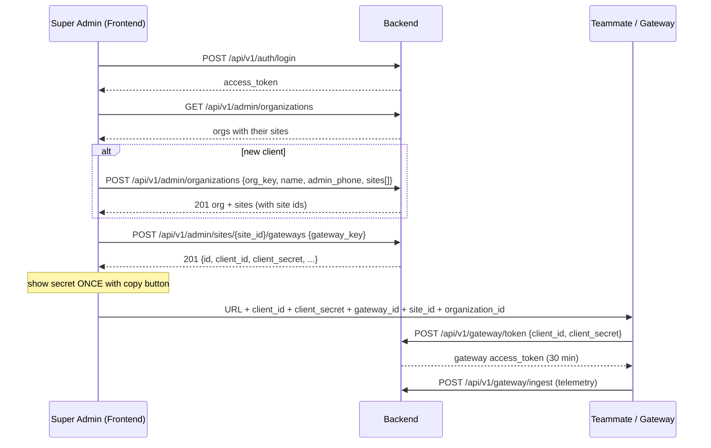

# UnityESS Central EMS — Frontend API Guide

How to connect a frontend to the EMS gateway backend: base URL, login, every endpoint
the frontend can call, and the order to call them in.

Interactive reference (every field, "Try it out" button): **https://ems-gateway-api.unityess.cloud/docs**

---

## 1. Basics

| | |
|---|---|
| Base URL | `https://ems-gateway-api.unityess.cloud` |
| Format | JSON in, JSON out (`Content-Type: application/json`) |
| Auth | `Authorization: Bearer <access_token>` on every call except login and health |
| Token lifetime | **15 minutes**. There is no refresh endpoint — on `401`, send the user back to login. |
| IDs | All `id`, `site_id`, `organization_id` values are UUID strings |
| Times | ISO-8601 / RFC3339 in UTC, e.g. `2026-10-30T05:34:09Z` |

### Error format

Every error returns a JSON body with `detail`:

```json
{ "detail": "Invalid credentials" }
```

For `422` validation errors, `detail` is a list describing each bad field:

```json
{ "detail": [ { "loc": ["body", "gateway_key"], "msg": "Field required", "type": "missing" } ] }
```

| Code | Meaning | What the frontend should do |
|---|---|---|
| 200 / 201 | OK / created | — |
| 400 | Bad request (e.g. site not in your org) | Show `detail` |
| 401 | Not logged in, or token expired | Clear token, go to login |
| 403 | Logged in but not allowed (wrong role or site) | Show "no access" |
| 404 | Not found | Show `detail` |
| 409 | Duplicate (org key, phone, gateway key) or limit reached | Show `detail` |
| 422 | Invalid input | Show field errors |
| 503 | Backend dependency unavailable | Show "try again later" |

---

## 2. Roles

| Role | How they log in | What they can do |
|---|---|---|
| **Super Admin** | Email + password | Everything: create clients (organizations) and sites, create gateway credentials, read all telemetry |
| **Org Admin** | Phone + OTP | Manage up to 2 operators for their org, read their org's telemetry |
| **Site Operator** | Phone + OTP | Read telemetry for the sites assigned to them |

> `GET /api/v1/auth/me` does **not** return the role. Today the only signal is
> `organization_id`: `null` → Super Admin; set → Org Admin or Operator.

---

## 3. Login flow

### 3a. Super Admin (email + password)



**`POST /api/v1/auth/login`** — no auth

Request:
```json
{ "identifier": "admin@example.com", "password": "••••••••" }
```
`identifier` is the user's email (or phone).

Response `200`:
```json
{ "access_token": "eyJhbGciOi...", "token_type": "bearer" }
```
Errors: `401 Invalid credentials` (wrong email/password, inactive user, or a user with no password).

### 3b. Org Admin / Operator (phone + OTP)



**`POST /api/v1/auth/otp/request`** — no auth
```json
{ "identifier": "+919876543210" }
```
Response `200`: `{ "status": "otp_sent" }`
Errors: `404 User not registered` · `403 OTP login is not allowed for this account` (Super Admin) · `400 No phone number registered for this account`

**`POST /api/v1/auth/otp/verify`** — no auth
```json
{ "identifier": "+919876543210", "otp": "123456" }
```
Response `200`: `{ "access_token": "...", "token_type": "bearer" }`
Errors: `401 Invalid or expired OTP` · `404` · `403` (as above)

> ⚠️ **OTP delivery is not live yet.** The backend uses a mock SMS provider, so no SMS is
> sent and Org Admin / Operator login cannot be completed until the MSG91 account is
> connected. Build the screens now; test with the Super Admin login.

### 3c. Current user

**`GET /api/v1/auth/me`** — any logged-in user

Response `200`:
```json
{ "id": "3f1c...", "email": "admin@example.com", "phone": null, "organization_id": null }
```

### 3d. Token handling (recommended)

```js
const API = "https://ems-gateway-api.unityess.cloud";

async function api(path, { method = "GET", body } = {}) {
  const res = await fetch(API + path, {
    method,
    headers: {
      "Content-Type": "application/json",
      ...(token() && { Authorization: `Bearer ${token()}` }),
    },
    body: body ? JSON.stringify(body) : undefined,
  });
  if (res.status === 401) { clearToken(); redirectToLogin(); return; }
  const data = await res.json().catch(() => null);
  if (!res.ok) throw new Error(typeof data?.detail === "string" ? data.detail : "Request failed");
  return data;
}

// login
const { access_token } = await api("/api/v1/auth/login", {
  method: "POST", body: { identifier: email, password },
});
saveToken(access_token);
```

---

## 4. Main flow: create gateway credentials for a teammate

This is the core Super Admin workflow: log in → choose (or create) a client and site →
generate a **client ID + client secret** → hand them to the person configuring the gateway.



### 4a. List clients and their sites

**`GET /api/v1/admin/organizations`** — Super Admin

Response `200`:
```json
[
  {
    "id": "b4612d66-c28b-4a5c-9d72-76b0941889d3",
    "org_key": "ornate",
    "name": "Ornate Solar",
    "sites": [
      { "id": "8ee34d55-9a15-40ca-98cf-a06dbe1ef2d4", "site_key": "site-01", "name": "Site 01" }
    ],
    "operators": [
      { "id": "…", "phone": "+91…", "email": null }
    ]
  }
]
```
Use this to fill the client and site dropdowns.

### 4b. Create a client (organization) with sites

**`POST /api/v1/admin/organizations`** — Super Admin

Request:
```json
{
  "org_key": "acme",
  "name": "Acme Industries",
  "admin_phone": "+919876543210",
  "admin_email": "ops@acme.com",
  "sites": [
    { "site_key": "acme-pune", "name": "Acme Pune Plant" }
  ]
}
```
- `org_key` — short unique code, letters/numbers/dashes
- `admin_phone` — required and unique; this person becomes the client's Org Admin (OTP login)
- `admin_email` — optional
- `sites` — one or more sites; can be empty

Response `201`:
```json
{
  "id": "…org uuid…",
  "org_key": "acme",
  "name": "Acme Industries",
  "admin_user_id": "…",
  "admin_phone": "+919876543210",
  "sites": [ { "id": "…site uuid…", "site_key": "acme-pune", "name": "Acme Pune Plant" } ]
}
```
Errors: `409 Organization key already exists` · `409 Phone number already registered`

### 4c. Generate client ID + client secret (register a gateway)

**`POST /api/v1/admin/sites/{site_id}/gateways`** — Super Admin

Request:
```json
{ "gateway_key": "ems-gw-2", "software_version": "1.0.0" }
```
- `gateway_key` — unique name for this gateway device (required)
- `software_version` — optional

Response `201`:
```json
{
  "id": "ed61e2a6-4866-4cde-8a8e-7a70e2a64efd",
  "site_id": "8ee34d55-9a15-40ca-98cf-a06dbe1ef2d4",
  "gateway_key": "ems-gw-2",
  "client_id": "gw_ef6ed9018b2c3479980586bf2a098d71",
  "client_secret": "FFUt…",
  "enabled": true
}
```
Errors: `404 Site not found` · `403 Site access denied` · `409 Gateway key already exists`

> ⚠️ **`client_secret` is returned only in this response.** The backend stores only a hash.
> Show it on a "credentials created" screen with copy buttons and a clear warning. If it is
> lost, register a new gateway with a different `gateway_key` (there is no reset endpoint yet).

**What to give the teammate** (a "copy all" block on that screen is ideal):

| Item | Where it comes from |
|---|---|
| Backend URL | `https://ems-gateway-api.unityess.cloud` |
| `client_id` | response above |
| `client_secret` | response above (once) |
| `gateway_id` | `id` in the response above |
| `site_id` | `site_id` in the response above |
| `organization_id` | the org's `id` from 4a / 4b |

The gateway must send exactly these `gateway_id`, `site_id` and `organization_id` values in
every telemetry message, or the backend rejects it with `403`.

### 4d. List gateways of a site

**`GET /api/v1/admin/sites/{site_id}/gateways`** — Super Admin

Response `200`:
```json
[
  { "id": "…", "site_id": "…", "gateway_key": "ems-gw-1", "client_id": "gw_…", "enabled": true }
]
```
No secrets are returned here.

---

## 5. Org Admin: operators

All three need an Org Admin login. An org can have at most **2 active** operators.

**`POST /api/v1/org/operators`**
```json
{ "phone": "+919812345678", "email": "op@acme.com", "site_ids": ["…site uuid…"] }
```
Response `201`:
```json
{ "id": "…", "phone": "+919812345678", "email": "op@acme.com", "is_active": true, "site_ids": ["…"] }
```
Errors: `409 Maximum of 2 active operators reached` · `409 Phone number already registered` ·
`400 One or more sites do not belong to your organization` · `403 Only an organization admin can manage operators`

**`GET /api/v1/org/operators`** → `200` list of the same objects.

**`POST /api/v1/org/operators/{operator_id}/deactivate`** (no body) → `200 { "status": "deactivated" }`
Errors: `404 Operator not found` · `409 Operator is already inactive`

---

## 6. Telemetry (dashboard data)

Read-only, for any logged-in role, limited to sites the user can see (Super Admin: all;
Org Admin: their org's sites; Operator: assigned sites). A site outside the user's scope
returns `403 Site access denied`.

Every telemetry call identifies one signal with four query parameters:

| Param | Example | Meaning |
|---|---|---|
| `site_id` | `8ee34d55-…` | Site to read |
| `stream` | `S1` or `S2` | `S1` = fast BESS data, `S2` = general/extended data |
| `substream` | `bess_fast`, `bms_extended`, `ems_system` | Group within the stream |
| `signal_key` | e.g. `soc` | Parameter name from the signal registry |

Unknown `stream` / `signal_key` → `422`. The list of valid substreams and signal keys comes
from the signal registry (ask the backend team for the current list).

### 6a. Latest value (live cards)

**`GET /api/v1/telemetry/latest?site_id=…&stream=S1&substream=bess_fast&signal_key=soc`**

Optional: `asset_id` (one battery/inverter), `source_id`. Without `asset_id` you get the
latest value for every asset at the site.

Response `200`:
```json
{
  "site_id": "8ee34d55-…", "stream": "S1", "substream": "bess_fast", "signal_key": "soc",
  "results": [
    { "asset_id": "bess-1", "source_id": "bms", "value": 76.5, "time": "2026-10-30T05:40:00Z" }
  ]
}
```

### 6b. Time series (charts)

**`GET /api/v1/telemetry/series?site_id=…&stream=S1&substream=bess_fast&signal_key=soc&asset_id=bess-1&start=-6h`**

| Param | Required | Notes |
|---|---|---|
| `asset_id` | yes | |
| `start` | yes | Relative (`-15m`, `-6h`, `-7d`; units `s m h d w`) or RFC3339 timestamp |
| `stop` | no | Defaults to now. Window max **7 days** |
| `limit` | no | Default 1000, max 5000 points |
| `source_id` | no | |

Response `200`:
```json
{
  "site_id": "…", "stream": "S1", "substream": "bess_fast", "signal_key": "soc", "asset_id": "bess-1",
  "points": [ { "time": "2026-10-30T00:00:00Z", "value": 74.1 } ],
  "truncated": false
}
```
`truncated: true` means there were more points than `limit` — narrow the range or use 6c.

### 6c. Aggregates (daily/hourly charts, min/max/avg)

**`GET /api/v1/telemetry/aggregate?site_id=…&stream=S1&substream=bess_fast&signal_key=soc&asset_id=bess-1&start=-7d&window=1h&fn=mean`**

| Param | Required | Notes |
|---|---|---|
| `asset_id` | yes | |
| `start` | yes | Same format as 6b; window max **366 days** |
| `window` | yes | Bucket size: `5m`, `1h`, `1d`, `1w` … (max 2000 buckets per request) |
| `fn` | yes | `mean`, `min`, `max`, `first`, `last`, `count` |
| `stop`, `source_id` | no | |

Response `200`: same as 6b plus `window` and `fn`, without `truncated`.

Errors for 6a–6c: `422` (bad signal, time range or window) · `501 signal retention bucket not available` ·
`503 telemetry store unavailable`.

---

## 7. Health (no auth)

| Endpoint | Response |
|---|---|
| `GET /health` | `{ "status": "ok", "service": "ems-backend" }` |
| `GET /ready` | `{ "status": "ok", "postgres": "ok", "redis": "ok" }` (`503` if a dependency is down) |

---

## 8. Not for the frontend

These are used by the gateway device only. Do not call them from the browser.

| Endpoint | Used by |
|---|---|
| `POST /api/v1/gateway/token` `{client_id, client_secret}` | Gateway gets a 30-minute token |
| `GET /api/v1/gateway/me` | Gateway checks its identity |
| `POST /api/v1/gateway/ingest` | Gateway sends telemetry (see `docs/gateway-contract-confirmation.md`) |

---

## 9. Suggested screens

| Screen | APIs |
|---|---|
| Login (email/password) | `POST /auth/login` → `GET /auth/me` |
| Login (phone/OTP) | `POST /auth/otp/request` → `POST /auth/otp/verify` → `GET /auth/me` |
| Clients list | `GET /admin/organizations` |
| New client | `POST /admin/organizations` |
| Site → Gateways | `GET /admin/sites/{site_id}/gateways` |
| New gateway / credentials | `POST /admin/sites/{site_id}/gateways` → show secret once |
| Operators (Org Admin) | `GET`/`POST /org/operators`, `POST /org/operators/{id}/deactivate` |
| Dashboard | `GET /telemetry/latest` (cards), `/series` and `/aggregate` (charts) |

---

## 10. Current limitations

| Item | Status |
|---|---|
| CORS | Not configured yet — the browser will block calls from another domain until the frontend URL is added on the backend |
| Token refresh | None; 15-minute tokens, re-login on `401` |
| OTP SMS | Mock provider; Org Admin / Operator login not usable yet |
| Role in `/auth/me` | Not returned; use `organization_id` as described in §2 |
| Gateway secret reset / disable | No endpoint yet; register a new gateway instead |
| Telemetry data | Empty until gateway ingestion is enabled |
